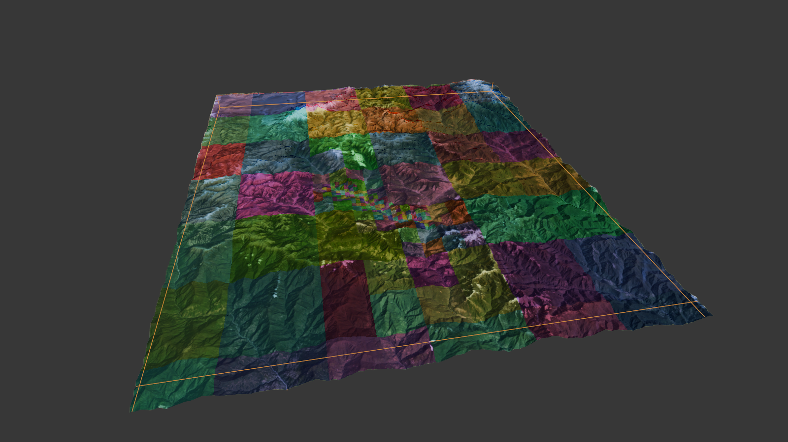

# X-Plane DSF & Ortho4XP Mesh (Blender extension)

Two X-Plane tile importers in one extension, for Blender 4.2+ (tested on Blender 5.2.2 LTS,
macOS):

* **Ortho4XP `.mesh`** — read *and write* the intermediate tile mesh, e.g.
  `Data+27+089.mesh`, with the tile's `.ter` orthophotos attached on import. This is the file
  to edit when water cuts, coastlines or airport levelling need fixing before the tile is
  rebuilt into a DSF.
* **X-Plane `.dsf`** — import the terrain mesh of a *shipped* scenery tile (including the
  7z-compressed Global Scenery files) with its terrain-type materials and textures. Import
  only: a DSF carries layers this add-on does not model, so it is never written back.



<table>
<tr>
<td></td>
<td></td>
</tr>
<tr>
<td><sub>An imported tile: one UV island per <code>.ter</code> cell, so the cell borders are visible as islands.</sub></td>
<td><sub>Close-up of the same. Import marks those borders as seams, so <i>Select Linked</i> / <i>Rip</i> work a whole cell at a time.</sub></td>
</tr>
</table>

---

## Install

This repository *is* the package: `blender_manifest.toml` plus four Python modules. There is
nothing to build and no Python packages to install outside Blender (`numpy` ships with
Blender; the `.mesh` codec itself is numpy-only).

It is packaged as a **Blender extension**, so it needs **Blender 4.2 or newer**.

**From the extensions platform** — *Edit → Preferences → Get Extensions*, search for
**Ortho4XP Mesh**, then *Install*.  (Listing: <https://extensions.blender.org/>)

**From a zip** — take `io_scene_ortho4xp_mesh-<version>.zip` from the
[releases](../../releases) page and use *Get Extensions → ⌄ → Install from Disk*. The archive
holds the package files at its root (no top folder) — that is what makes it an extension
rather than a legacy add-on folder.

**From a git checkout** — symlink the checkout into a local repository and Blender loads your
working copy, so `git pull` (or an edit) is all it takes:

```sh
mkdir -p ~/Library/Application\ Support/Blender/5.2/extensions/user_default
ln -s /path/to/io_scene_ortho4xp_mesh \
      ~/Library/Application\ Support/Blender/5.2/extensions/user_default/io_scene_ortho4xp_mesh
```

| OS | user_default repository |
|---|---|
| macOS | `~/Library/Application Support/Blender/<version>/extensions/user_default/` |
| Windows | `%APPDATA%\Blender Foundation\Blender\<version>\extensions\user_default\` |
| Linux | `~/.config/blender/<version>/extensions/user_default/` |

**Enable it:** *Edit → Preferences → Get Extensions*, find **Ortho4XP Mesh Import/Export** in
the installed list and tick it.

> **Not a legacy add-on any more.** The package carries no legacy metadata (it lives in
> `blender_manifest.toml`), so a copy dropped into `scripts/addons/` is ignored — Blender
> 4.0/4.1 cannot load this version at all. Use the extensions paths above.

**Where it appears:**

* `File → Import → Ortho4XP Mesh (.mesh)`
* `File → Import → X-Plane DSF (terrain, .dsf)`
* `File → Export → Ortho4XP Mesh (.mesh)`
* 3D viewport sidebar (`N`) → tab **Ortho4XP** — tile info, triangle attributes, texture
  stats, and the *Seams from Islands* / *Fix to map* / *Projected UVs* buttons

**Requirements:** Blender 4.2 or newer (extension; tested on 5.2.2 LTS). The `.mesh` parser
and the `.ter` face assignment are `bpy`-free, so they also run headless with plain `numpy`
(that is how they are verified — see [doc/verification.md](doc/verification.md)).

---

## Quick start

Video walkthrough: **https://youtu.be/eY7cQnDdXa8**

```
Ortho4XP ──▶ create scenery ──▶ Data+27+089.mesh
                                      │
                                Blender import → edit → export   (same file)
                                      │
Ortho4XP ──▶ build imagery + DSF ─────┘ ──▶ Earth nav data/+27+089/+27+089.dsf ──▶ X-Plane
```

1. **Ortho4XP → *Create scenery*** (steps 1–2). This writes the intermediate
   `Data+27+089.mesh` next to the tile.
2. **Blender → `File ▸ Import ▸ Ortho4XP Mesh (.mesh)`**, pick that file. The tile comes in
   as editable geometry in metres (X east, Y north, Z up), with the orthophotos attached.
3. **Edit** — move vertices at water cuts, coastlines, airport flattening, spikes. N-gons,
   new vertices and deleted faces are all fine.
4. **Blender → `File ▸ Export ▸ Ortho4XP Mesh (.mesh)`**, overwrite the same file (tick
   *Recompute normals* if you moved vertices).
5. **Ortho4XP → *Build Imagery + DSF*** (step 3) — it reads that `.mesh` and rebuilds the
   `.dsf` X-Plane loads.

> ⚠️ **After editing, run step 3 — never re-run step 1–2.** Steps 1–2 rebuild the mesh from
> scratch and throw your edits away. Back the file up (Ortho4XP's own `Data+….mesh.back`) if
> you want to experiment.

A `.mesh` is one 1×1° tile and X-Plane never reads it; it is the file to edit when a tile's
water cuts or flattening need fixing. The two HTML diagrams below draw the same workflow in
more detail.

---

## Documentation

| Document | Contents |
|---|---|
| [doc/ortho4xp-mesh-format.md](doc/ortho4xp-mesh-format.md) | the `.mesh` format: MEDITS structure, both Ortho4XP flavours, units, the triangle region bit mask, the sibling `.node`/`.poly`/`.alt`/`.apt` files, editing pitfalls |
| [doc/terrain-textures.md](doc/terrain-textures.md) | how the tile's `.ter` cells become materials + UVs, the lattice tiling, and the `tex_limit` / `tex_max_px` memory knobs |
| [doc/import-and-export.md](doc/import-and-export.md) | every import and export option, the sidebar panel, what survives a round trip and what does not |
| [doc/dsf-import.md](doc/dsf-import.md) | the DSF importer: 7z decoding, what is imported, the `.ter` mappings, known limits |
| [doc/verification.md](doc/verification.md) | the `verify/` scripts, measured results on real tiles, repository layout |
| [doc/extensions-listing.md](doc/extensions-listing.md) | the text used for the extensions.blender.org listing, kept in sync with `blender_manifest.toml` |
| [doc/workflow-en.html](doc/workflow-en.html) | workflow diagram (English) — standalone HTML, open in a browser |
| [doc/ortho4xp-blender-workflow.html](doc/ortho4xp-blender-workflow.html) | 工作流图解（中文）— standalone HTML |