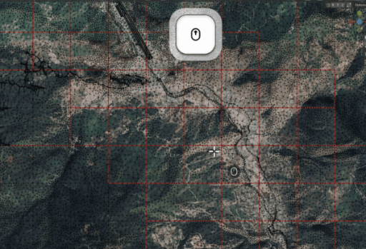
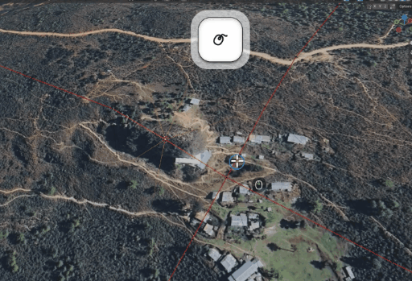

# Ortho4XP Mesh Import/Export (Blender addon)

Read and write Ortho4XP tile meshes — `Data+50-125.mesh`, `Data+27+089.mesh` etc. — in
Blender 4.0+ (tested on Blender 5.2.2 LTS, macOS), with the tile's `.ter`
orthophotos attached on import.

<table>
<tr>
<td></td>
<td></td>
</tr>
<tr>
<td><sub>An imported tile: one UV island per <code>.ter</code> cell, so the cell borders are visible as islands.</sub></td>
<td><sub>Close-up of the same. Import marks those borders as seams, so <i>Select Linked</i> / <i>Rip</i> work a whole cell at a time.</sub></td>
</tr>
</table>

---

## Install

This folder *is* the addon. There is nothing to build and no Python packages to install
outside Blender (`numpy` ships with Blender; the `.mesh` codec itself is numpy-only).

**1. Put the folder where Blender looks for addons:**

| OS | Addon folder |
|---|---|
| macOS | `~/Library/Application Support/Blender/<version>/scripts/addons/` |
| Windows | `%APPDATA%\Blender Foundation\Blender\<version>\scripts\addons\` |
| Linux | `~/.config/blender/<version>/scripts/addons/` |

Copy it in, or symlink it so that `git pull` updates your Blender in place:

```sh
ln -s /path/to/io_scene_ortho4xp_mesh \
      ~/Library/Application\ Support/Blender/5.2/scripts/addons/io_scene_ortho4xp_mesh
```

Keep the folder name `io_scene_ortho4xp_mesh` — it is the module name Blender imports.

**2. Enable it:** *Edit → Preferences → Add-ons*, search for **Ortho4XP Mesh**, tick
**Ortho4XP Mesh Import/Export**.

*Alternative:* zip this folder and use *Install from Disk…* in the same panel (the ZIP has
to contain the `io_scene_ortho4xp_mesh` folder as its top level).

**3. Where it appears:**

* `File → Import → Ortho4XP Mesh (.mesh)`
* `File → Export → Ortho4XP Mesh (.mesh)`
* 3D viewport sidebar (`N`) → tab **Ortho4XP** — tile info, triangle attributes, texture
  stats, and the *Seams from Islands* / *Fix to map* / *Projected UVs* buttons

**Requirements:** Blender 4.0 or newer. The `.mesh` parser and the `.ter` face assignment
are `bpy`-free, so they also run headless with plain `numpy` (that is how they are
verified — see [doc/verification.md](doc/verification.md)).

---

## Quick start

Video walkthrough: **https://youtu.be/eY7cQnDdXa8**

```
Ortho4XP ──▶ create scenery ──▶ Data+27+089.mesh
                                      │
                                Blender import → edit → export   (same file)
                                      │
Ortho4XP ──▶ build imagery + DSF ─────┘ ──▶ Earth nav data/+27+089/+27+089.dsf ──▶ X-Plane
```

1. **Ortho4XP → *Create scenery*** (steps 1–2). This writes the intermediate
   `Data+27+089.mesh` next to the tile.
2. **Blender → `File ▸ Import ▸ Ortho4XP Mesh (.mesh)`**, pick that file. The tile comes in
   as editable geometry in metres (X east, Y north, Z up), with the orthophotos attached.
3. **Edit** — move vertices at water cuts, coastlines, airport flattening, spikes. N-gons,
   new vertices and deleted faces are all fine.
4. **Blender → `File ▸ Export ▸ Ortho4XP Mesh (.mesh)`**, overwrite the same file (tick
   *Recompute normals* if you moved vertices).
5. **Ortho4XP → *Build Imagery + DSF*** (step 3) — it reads that `.mesh` and rebuilds the
   `.dsf` X-Plane loads.

> ⚠️ **After editing, run step 3 — never re-run step 1–2.** Steps 1–2 rebuild the mesh from
> scratch and throw your edits away. Back the file up (Ortho4XP's own `Data+….mesh.back`) if
> you want to experiment.

A `.mesh` is one 1×1° tile and X-Plane never reads it; it is the file to edit when a tile's
water cuts or flattening need fixing. The two HTML diagrams below draw the same workflow in
more detail.

---

## Documentation

| Document | Contents |
|---|---|
| [doc/ortho4xp-mesh-format.md](doc/ortho4xp-mesh-format.md) | the `.mesh` format: MEDITS structure, both Ortho4XP flavours, units, the triangle region bit mask, the sibling `.node`/`.poly`/`.alt`/`.apt` files, editing pitfalls |
| [doc/terrain-textures.md](doc/terrain-textures.md) | how the tile's `.ter` cells become materials + UVs, the lattice tiling, and the `tex_limit` / `tex_max_px` memory knobs |
| [doc/import-and-export.md](doc/import-and-export.md) | every import and export option, the sidebar panel, what survives a round trip and what does not |
| [doc/verification.md](doc/verification.md) | the `verify/` scripts, measured results on real tiles, repository layout |
| [doc/workflow-en.html](doc/workflow-en.html) | workflow diagram (English) — standalone HTML, open in a browser |
| [doc/ortho4xp-blender-workflow.html](doc/ortho4xp-blender-workflow.html) | 工作流图解（中文）— standalone HTML |